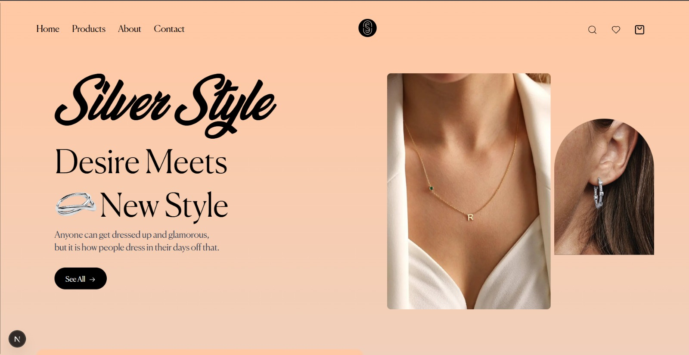
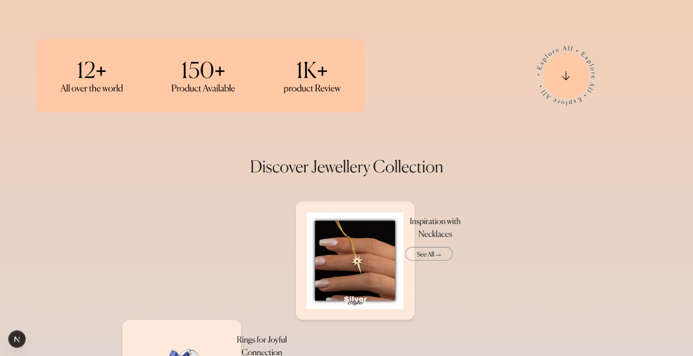
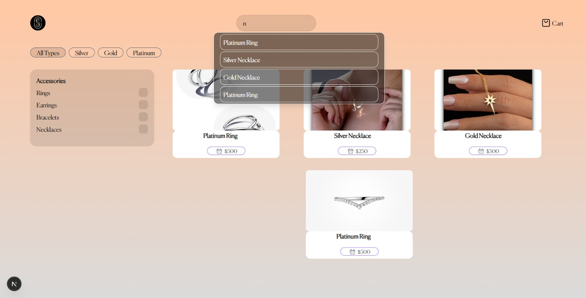
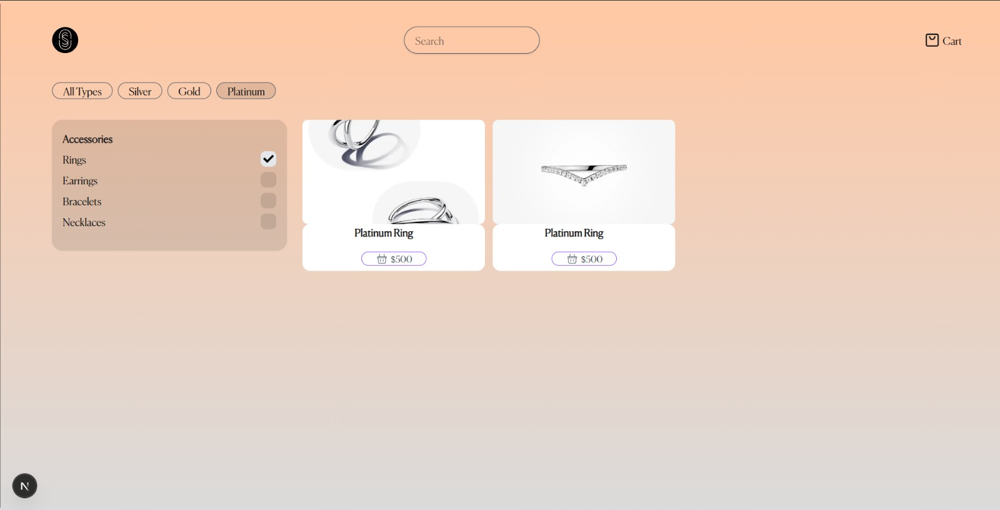
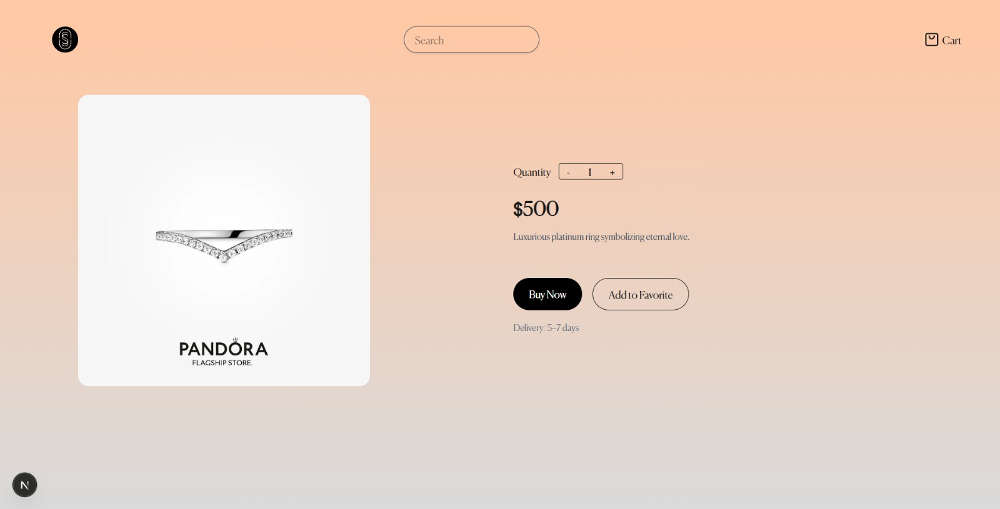
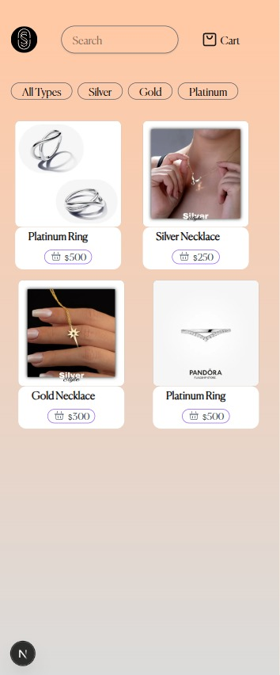
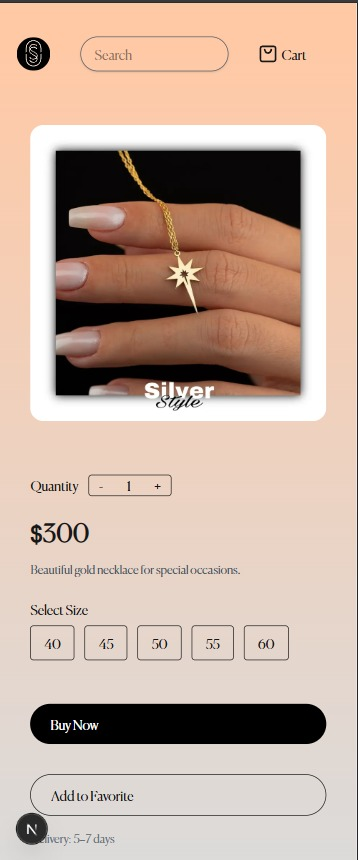

# 🛒 SilverStyle – Full-Stack E-commerce Application

## 📌 Project Overview

SilverStyle is a full-stack e-commerce web application built using **Next.js (Frontend)** and **ASP.NET Core (Backend)** with **MySQL** as the database.
.

The application allows users to browse products, add items to cart, and manage their shopping cart.

The project follows clean architecture principles and demonstrates real-world full-stack development practices.

---

## ✨ Features

### 🛍 Product Management
- Fetch products from MySQL
- Product details page
- RESTful API structure

### 🛒 Cart System
- Add to cart
- Remove from cart
- Update product quantity
- Global state management using Zustand

### 📱 UI/UX
- Fully responsive design
- Clean and modern layout
- Built with Tailwind CSS

---

## 🛠 Tech Stack

### Frontend
- Next.js
- TypeScript
- Zustand
- Tailwind CSS

### Backend
- C#
- ASP.NET Core
- MySQL
- Entity Framework Core

---

## 🏗 Architecture

Client (Next.js) → REST API (ASP.NET Core) → MySQL Database

- Frontend communicates with backend via REST APIs
- Backend handles database operations

---
## 📸 Screenshots

### 🏠 Home Page

### 🛍 Product Page

